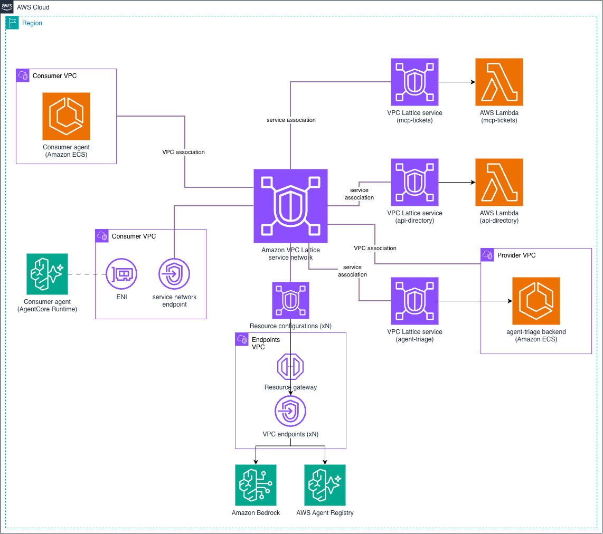

# Amazon VPC Lattice - Direct Agent Connectivity (no AI gateway)

This pattern connects AI agents directly to the tools, APIs and agents they call, with VPC Lattice handling the connectivity and the service-to-service access control. Each backend is a VPC Lattice **service** with its own auth policy, so every call is authorized per agent, and the AWS services the agents need are reached as VPC **resources** in the same service network.

> **Use case**: an IT helpdesk agent looks up an employee in the **directory** API, opens a ticket with the **tickets** MCP server, and asks the **triage** agent for a priority. The agents have no backend configuration: they find the backends in AWS Agent Registry on every request, and each backend owner decides which agents may call it.



> **Note**: To compare this pattern with the others in this section, with and without an AI gateway, see the [Agentic Architectures overview](../).

## Simple and secure agent connectivity

Three AWS capabilities together cover what agents need to find and call their backends securely:

- **Amazon VPC Lattice (connectivity and agent-level access)**: one service network connects every agent, tool, API and AWS endpoint. No VPC peering, transit gateway, route tables or NAT, and the VPCs can use the same CIDR (all of them use `10.0.0.0/16` here). The consumer VPCs have no internet access and no interface endpoints of their own. Every HTTP request to a VPC Lattice service is signed with the agent's IAM role (SigV4), so VPC Lattice knows which agent is calling and decides on every request. The calls to the AWS endpoints travel as TCP connections to VPC resources, so VPC Lattice doesn't see the caller there; IAM and the endpoint policies authorize those calls.
- **AWS Agent Registry (discovery)**: the agents only know where the registry is. On every request, the agent reads the registry records (each service's URL and its MCP tools, REST operations or A2A skills), and the model decides which service to call from them. Adding, moving or retiring a backend means updating its record, not the agents. Discovery doesn't grant access; VPC Lattice still decides whether each call is allowed. To learn more, see the [AWS Agent Registry documentation](https://docs.aws.amazon.com/bedrock-agentcore/latest/devguide/registry.html).
- **Amazon Bedrock AgentCore Identity (user identity)**: carries the identity of the user the agent acts for, so the backends can make user-level decisions. To learn more, see the [Amazon Bedrock AgentCore Identity documentation](https://docs.aws.amazon.com/bedrock-agentcore/latest/devguide/identity.html).

> **Note**: This pattern deploys VPC Lattice and AWS Agent Registry. AgentCore Identity is part of the overall solution and is explained in [Security architecture](#security-architecture), but it isn't deployed, to keep the pattern easy to understand and consume while it focuses on the VPC Lattice implementation. It builds on the same network without changes.

The two consumer VPCs show both ways a VPC connects to the service network. Each service has a custom domain name, so its registry record holds one URL that works from both consumer VPCs, resolved by a private hosted zone in each one. The AWS endpoints resolve through private DNS configuration (at VPC association and VPC endpoint level) in both VPCs.

| Consumer | Connects through | Service domain names resolve to |
|----------|------------------|---------------------------------|
| `agent-ecs` (VPC A) | VPC association | The service's DNS name |
| `agent-runtime` (VPC B) | Service network endpoint | The DNS name VPC Lattice creates for the service on the endpoint |

The pattern deploys everything in one account to keep it simple. Across accounts, it follows the [Multi-Account Patterns](../../2-multi_account/): the service network and the services are shared over AWS RAM, centralized or distributed, and each auth policy names the agent roles of the consumer accounts. The registry is [shared over AWS RAM](https://docs.aws.amazon.com/bedrock-agentcore/latest/devguide/registry-cross-account-sharing.html) too, so agents in other accounts discover the same records, and each consumer account keeps its own private hosted zone for the custom domain names.

## What gets deployed

| Component | Details |
|-----------|---------|
| **Endpoints VPC** | Interface endpoints for `bedrock-runtime`, `bedrock-agentcore`, `agent-registry`, `ecr.api`, `ecr.dkr`, `logs`, `sts` and `ssmmessages`, a resource gateway, and one single resource configuration per endpoint (custom domain name = the service's standard DNS name) |
| **Service network** | `AWS_IAM` auth type with a service network policy that requires authentication, resource associations for the central endpoints (private DNS), and access logging |
| **`mcp-tickets`** | MCP server (Streamable HTTP, stateless) on AWS Lambda, published as a VPC Lattice service |
| **`api-directory`** | REST API (`GET /employees`, `GET /employees/{id}`, `POST /employees`) on AWS Lambda, published as a VPC Lattice service |
| **`agent-triage`** | A2A agent (Strands Agents) on Amazon ECS in the provider VPC, published as a VPC Lattice service. The provider VPC also joins the service network to reach the central endpoints |
| **Consumer VPC A** | `agent-ecs` (Strands Agents on Amazon ECS Fargate), VPC association with private DNS, and a private hosted zone for the services' custom domain names |
| **Consumer VPC B** | `agent-runtime` (the same agent image on AgentCore Runtime, VPC mode), service network endpoint with private DNS, and a private hosted zone for the services' custom domain names |
| **AWS Agent Registry** | An IAM registry with one record per service (MCP server, custom REST API descriptor, A2A agent card). The registry can't synchronize records from private endpoints, so the IaC creates them with their descriptors inline and submits them for approval (auto-approved). The agents read these records on every request to find the backends |
| **Amazon S3 gateway endpoints** | One per VPC that pulls container images (gateway endpoints can't be centralized) |

| Flow | Path | Decided by |
|------|------|------------|
| Agent -> MCP | `mcp-tickets` service | Auth policy on the agent role (per server) |
| Agent -> API | `api-directory` service | Auth policy on the agent role, HTTP method and path |
| Agent -> agent | `agent-triage` service (A2A JSON-RPC) | Auth policy on the agent role |
| `agent-ecs` -> `agent-runtime` | `bedrock-agentcore` VPC resource (`InvokeAgentRuntime`) | IAM (`bedrock-agentcore:InvokeAgentRuntime`) |
| Agent -> LLM / registry | `bedrock-runtime` and `agent-registry` VPC resources | IAM and the endpoint policies |

## Security architecture

Security works at two levels: VPC Lattice decides which **agent** may call which backend, and each backend decides what the **user** the agent acts for may do. The access logs record every decision.

### Agent-level access: auth policies

Access is checked in two layers. The service network allows only authenticated (SigV4-signed) requests, using the [require-authentication](../../4-auth_policies/policies/require-authentication.json) policy. Then each service's auth policy allows only specific agent roles, and on the directory API only specific HTTP methods, so each service owner decides who calls their service. For how auth policies are evaluated and more policy examples, see [Auth Policies & SigV4](../../4-auth_policies/).

| Agent role | `mcp-tickets` | `api-directory` | `agent-triage` |
|------------|---------------|-----------------|----------------|
| `agent-ecs` | ✅ | ✅ `GET` and `POST` | ✅ |
| `agent-runtime` | ✅ | ✅ `GET` only | ✅ |

### User-level access: AgentCore Identity

VPC Lattice authorizes the agent, not the user the agent acts for. User-level decisions (*Ana may read her own tickets, not everyone's*) are enforced by each backend, with [Amazon Bedrock AgentCore Identity](https://docs.aws.amazon.com/bedrock-agentcore/latest/devguide/on-behalf-of-token-exchange.html) providing the user's identity. Identities are configured centrally, and the fine-grained decisions are distributed to the backends. This pattern doesn't deploy it.

- **Managed centrally**: an OAuth2 credential provider (the connection to your identity provider, with its client secret kept in AgentCore Identity) and a workload identity per agent. AgentCore Runtime creates the workload identity for `agent-runtime`; a self-hosted agent like `agent-ecs` gets one created for it.
- **Obtained per request**: the agent receives the user's token, exchanges it on behalf of the user for a token scoped to the downstream service (carrying both the user and the agent identity), and sends it with the SigV4-signed call. VPC Lattice decides which agent may call, and the backend validates the token and decides what the user may do.
- **Network**: the agents reach AgentCore Identity through the centralized `bedrock-agentcore` endpoint already in the service network, and AgentCore Identity calls the identity provider itself, so the agent VPCs still need no internet access.

> **Note**: VPC Lattice allows or denies an MCP server as a whole, not per tool, because MCP sends every call as a `POST` to one path. Per-tool rules live in the MCP server itself. When many tools need per-tool policy managed in one place, that is a reason to put an AI gateway in front of them.

### Observability

The service network sends its access logs to CloudWatch Logs (`/aws/vpclattice/<identifier>`), for both log types:

- **`SERVICE`**: one entry per request to `mcp-tickets`, `api-directory` and `agent-triage`, with the caller principal, the auth decision (`authDeniedReason` when denied), the target and the status code.
- **`RESOURCE`**: the connections to the centralized endpoints, such as the model calls to Amazon Bedrock and the lookups in AWS Agent Registry.

The agents, the triage agent and the Lambda functions write their application logs to CloudWatch Logs as well.

## Prerequisites

- **Amazon Bedrock model access** for the model in `model_id` / `MODEL_ID` (default `eu.anthropic.claude-haiku-5-5`), used by the consumer agents and the triage agent.
- **Docker with `buildx`**: the agent and triage images are built for `linux/arm64`, because AgentCore Runtime runs ARM64 containers. On an x86 machine, `buildx` needs QEMU emulation.
- **An AWS Region where AgentCore Runtime VPC mode and AWS Agent Registry are available**, and where AgentCore Runtime supports the Availability Zones the VPCs use. See [Supported Availability Zones](https://docs.aws.amazon.com/bedrock-agentcore/latest/devguide/agentcore-vpc.html#agentcore-supported-azs).
- **A domain and an ACM certificate** for the services' custom domain names (`<service>.<domain>`). The certificate must cover `*.<domain>` and be in the account and Region you deploy to; see [Custom domain names for VPC Lattice services](https://docs.aws.amazon.com/vpc-lattice/latest/ug/service-custom-domain-name.html).
- **The [Session Manager plugin for the AWS CLI](https://docs.aws.amazon.com/systems-manager/latest/userguide/session-manager-working-with-install-plugin.html)**, installed on the machine you test from: chatting with `agent-ecs` goes through ECS Exec. Testing `agent-runtime` doesn't need it.

> **Note**: The default model is an example. Use the model your organization approves and that fits your use case (quality, latency, cost and data residency); the agents only need its model or inference profile ID.

## Implementation

| IaC Tool | Location |
|----------|----------|
| **CloudFormation** | [`./cloudformation/`](./cloudformation/) |
| **Terraform** | [`./terraform/`](./terraform/) |

Both implementations build the agent and triage images from [`../applications/`](../applications/), shared by every pattern in this section.

## Testing Connectivity

Connect to either consumer agent and pilot it with the example prompts. The chat client lists them when it starts: type a number to send one, or type your own prompt. Each prompt is a separate invocation, so the agent doesn't keep the conversation between prompts.

| IaC Tool | From | `agent-ecs` (ECS Exec) | `agent-runtime` (`InvokeAgentRuntime`) |
|----------|------|------------------------|----------------------------------------|
| **Terraform** | [`./terraform/`](./terraform/) | `./chat.sh ecs` | `./chat.sh runtime` |
| **CloudFormation** | [`./cloudformation/`](./cloudformation/) | `make chat AGENT=ecs` | `make chat AGENT=runtime` |

<details>
<summary>Click to expand testing steps</summary>

After each reply, the chat client prints the **calls made**: each model turn in Amazon Bedrock (`bedrock-runtime` VPC resource) with what the model decided to do next, and each call it made with its result. The agents have no backend URLs configured: every prompt starts with a lookup in AWS Agent Registry, through its centralized endpoint, and the model then calls the services the registry returned through VPC Lattice. Each step shows the expected output from `agent-ecs`. `agent-runtime` makes the same calls with the same results, except in step 4, where its role is denied the `POST`. The model's wording varies, and it may add or reorder calls.

#### Step 1: Look up an employee (REST API, `GET`)

```text
you> Who is Ana? Which department is she in and which device does she use?
  Calls made:
  1. model in Amazon Bedrock (bedrock-runtime): decides to call discover_services({})
  2. agent-registry: ListDiscoverableRegistryRecords, BatchGetDiscoverableRegistryRecord -> agent-triage, api-directory, mcp-tickets
  3. model in Amazon Bedrock (bedrock-runtime): decides to call call_rest_api({"service": "api-directory", "method": "GET", "path": "/employees"})
  4. api-directory: GET /employees -> 200
  5. model in Amazon Bedrock (bedrock-runtime): writes the final answer
agent-ecs> Ana is Ana Garcia (employee ID `ana`). She works in the **Engineering** department and uses the device **laptop-0042**.
```

#### Step 2: Report an issue (REST API, A2A and MCP)

```text
you> Ana's laptop doesn't boot and she can't work. How urgent is it?
  Calls made:
  1. model in Amazon Bedrock (bedrock-runtime): decides to call discover_services({})
  2. agent-registry: ListDiscoverableRegistryRecords, BatchGetDiscoverableRegistryRecord -> api-directory, mcp-tickets, agent-triage
  3. model in Amazon Bedrock (bedrock-runtime): decides to call call_rest_api({"service": "api-directory", "method": "GET", "path": "/employees"})
  4. api-directory: GET /employees -> 200
  5. model in Amazon Bedrock (bedrock-runtime): decides to call send_agent_message({"service": "agent-triage", "text": "Priority request for a helpdesk issue. Employee: Ana Garcia (id: ana, Engineering, device laptop-0042). Issue: laptop does not boot and she cannot work. How urgent is it? Please reply with a priority level and brief reasoning."})
  6. agent-triage: A2A message/send -> 200
  7. model in Amazon Bedrock (bedrock-runtime): decides to call call_mcp_tool({"service": "mcp-tickets", "tool_name": "create_ticket", "arguments": {"employee_id": "ana", "priority": "high", "summary": "Laptop laptop-0042 does not boot; employee Ana Garcia is unable to work. Priority set to high by triage agent."}})
  8. mcp-tickets: MCP tools/call create_ticket -> 200
  9. model in Amazon Bedrock (bedrock-runtime): writes the final answer
agent-ecs> The urgency is **high**. The triage agent rated it high because a laptop that won't boot leaves Ana unable to work.

I opened ticket **TCK-15756635** for Ana Garcia (laptop-0042), with priority high and a summary of the no-boot issue.
```

The triage agent decides the priority with its own model call, from the provider VPC through the same central `bedrock-runtime` endpoint.

#### Step 3: Open and list tickets (MCP)

```text
you> Open a ticket for Ana: her laptop doesn't boot.
  Calls made:
  1. model in Amazon Bedrock (bedrock-runtime): decides to call discover_services({})
  2. agent-registry: ListDiscoverableRegistryRecords, BatchGetDiscoverableRegistryRecord -> agent-triage, mcp-tickets, api-directory
  3. model in Amazon Bedrock (bedrock-runtime): decides to call call_rest_api({"service": "api-directory", "method": "GET", "path": "/employees"}), send_agent_message({"service": "agent-triage", "text": "IT issue: Ana's laptop doesn't boot. Please assign a priority."})
     "Ana needs to be found in the directory first."
  4. api-directory: GET /employees -> 200
  5. agent-triage: A2A message/send -> 200
  6. model in Amazon Bedrock (bedrock-runtime): decides to call call_mcp_tool({"service": "mcp-tickets", "tool_name": "create_ticket", "arguments": {"employee_id": "ana", "summary": "Laptop (laptop-0042) doesn't boot.", "priority": "High"}})
  7. mcp-tickets: MCP tools/call create_ticket -> 200
  8. model in Amazon Bedrock (bedrock-runtime): writes the final answer
agent-ecs> I opened ticket **TCK-f29cb15a** for Ana Garcia (Engineering). The summary is "Laptop (laptop-0042) doesn't boot." and the priority is **High**. The triage agent gave that priority because a laptop that won't boot stops her from working.

you> Which tickets are open for Ana?
  Calls made:
  1. model in Amazon Bedrock (bedrock-runtime): decides to call discover_services({})
  2. agent-registry: ListDiscoverableRegistryRecords, BatchGetDiscoverableRegistryRecord -> agent-triage, mcp-tickets, api-directory
  3. model in Amazon Bedrock (bedrock-runtime): decides to call call_rest_api({"service": "api-directory", "method": "GET", "path": "/employees"})
  4. api-directory: GET /employees -> 200
  5. model in Amazon Bedrock (bedrock-runtime): decides to call call_mcp_tool({"service": "mcp-tickets", "tool_name": "list_tickets", "arguments": {"employee_id": "ana"}})
  6. mcp-tickets: MCP tools/call list_tickets -> 200
  7. model in Amazon Bedrock (bedrock-runtime): writes the final answer
agent-ecs> Ana Garcia (ana) has one open ticket: **TCK-f29cb15a**, priority High, for her laptop (laptop-0042) not booting.
```

#### Step 4: Add an employee (REST API, `POST`)

This step is the one where the two consumer agents get different results. Both send the same `POST /employees` request, but the `api-directory` auth policy allows `POST` for the `agent-ecs` role only (`agent-runtime` may only `GET`), so VPC Lattice allows one and denies the other before the request reaches the API. Run the prompt from each agent.

**From `agent-ecs`** (`./chat.sh ecs` or `make chat AGENT=ecs`): allowed.

```text
you> Add Zoe Lee to the directory with the identifier zoe.
  Calls made:
  1. model in Amazon Bedrock (bedrock-runtime): decides to call discover_services({})
  2. agent-registry: ListDiscoverableRegistryRecords, BatchGetDiscoverableRegistryRecord -> agent-triage, mcp-tickets, api-directory
  3. model in Amazon Bedrock (bedrock-runtime): decides to call call_rest_api({"service": "api-directory", "method": "POST", "path": "/employees", "body": {"id": "zoe", "name": "Zoe Lee"}})
  4. api-directory: POST /employees -> 201
  5. model in Amazon Bedrock (bedrock-runtime): writes the final answer
agent-ecs> Zoe Lee has been added to the directory with the identifier `zoe`.
```

**From `agent-runtime`** (`./chat.sh runtime` or `make chat AGENT=runtime`): denied by VPC Lattice (`403`).

```text
you> Add Zoe Lee to the directory with the identifier zoe.
  Calls made:
  1. model in Amazon Bedrock (bedrock-runtime): decides to call discover_services({})
  2. agent-registry: ListDiscoverableRegistryRecords, BatchGetDiscoverableRegistryRecord -> agent-triage, mcp-tickets, api-directory
  3. model in Amazon Bedrock (bedrock-runtime): decides to call call_rest_api({"service": "api-directory", "method": "POST", "path": "/employees", "body": {"id": "zoe", "name": "Zoe Lee"}})
  4. api-directory: POST /employees -> 403
  5. model in Amazon Bedrock (bedrock-runtime): writes the final answer
agent-runtime> I couldn't add Zoe Lee to the directory. The call `POST /employees` on the `api-directory` service was denied with an HTTP 403 (AccessDeniedException). The agent's role isn't authorized to invoke the employees endpoint through VPC Lattice. I didn't retry, since this is a permissions issue, not a transient error.
```

Both agents discover the same services in the registry: discovery doesn't grant access, the auth policy does.

#### Step 5: Read the access logs

```bash
aws logs tail /aws/vpclattice/<identifier> --since 15m
```

**Expected Result**: one `SERVICE` entry per call to `mcp-tickets`, `api-directory` and `agent-triage`, with the caller principal (each agent's role), the auth decision (`authDeniedReason` on the `403` from step 4), the path and the status code. The model and AWS Agent Registry calls appear as `RESOURCE` entries (connections to the `bedrock-runtime` and `agent-registry` resource configurations), without a caller principal.

</details>

> **Note**: VPC Lattice closes connections after their maximum duration, and long-lived streams (MCP or A2A server-sent events) need to reconnect. The tools in this pattern answer with plain JSON. Review the current values in [VPC Lattice quotas](https://docs.aws.amazon.com/vpc-lattice/latest/ug/quotas.html).

## Cleanup

Tear down the resources when you are finished to stop incurring charges. While deployed, this pattern runs ECS tasks, an AgentCore Runtime agent, interface endpoints, VPC Lattice resource configurations, and CloudWatch Logs vended-logs access logging.

| IaC Tool | From | Command |
|----------|------|---------|
| **Terraform** | [`./terraform/`](./terraform/) | `terraform destroy` |
| **CloudFormation** | [`./cloudformation/`](./cloudformation/) | `make undeploy` |

> **Note**: AgentCore Runtime ENIs can remain in consumer VPC B for some hours after the agent is deleted (see [AgentCore Runtime VPC](https://docs.aws.amazon.com/bedrock-agentcore/latest/devguide/agentcore-vpc.html)). If the VPC fails to delete, run the teardown again later.

## Next Steps

1. **Put an AI gateway in front**: compare with the [self-hosted AI gateway](../2-self_hosted_ai_gateway/) and [Amazon Bedrock AgentCore Gateway](../3-agentcore_gateway/) patterns.
2. **Write your own access rules**: adapt a policy from the [Auth Policies & SigV4 toolkit](../../4-auth_policies/), for example by organization, account or principal tag.
