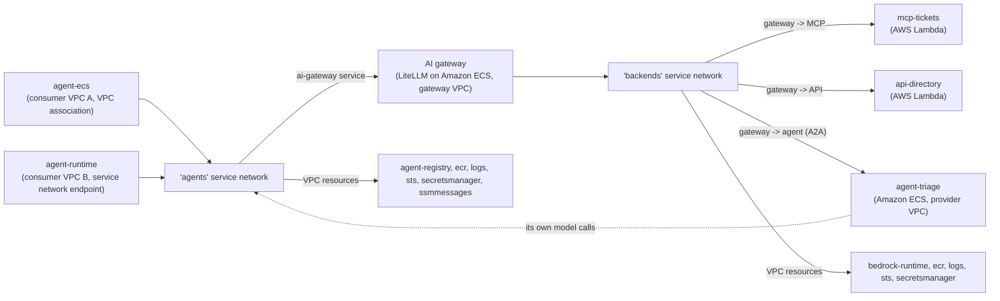

# Amazon VPC Lattice - Self-Hosted AI Gateway (LiteLLM)

This pattern puts a self-hosted AI gateway between the agents and everything they call, with VPC Lattice making the gateway the only way through. The agents reach the gateway as a VPC Lattice **service** in one service network, and the gateway reaches the tools, APIs, agents and model in a second one, so every call is authorized by VPC Lattice at both hops and governed by the gateway in between.

> **Note**: The pattern uses [LiteLLM](https://docs.litellm.ai/) as an example of a self-hosted AI gateway, to keep the implementation simple. It doesn't cover how to use LiteLLM: it shows how to place a self-hosted AI gateway in VPC Lattice. Other gateways follow the same pattern: publish the gateway as the `ai-gateway` service and describe its endpoints in AWS Agent Registry.

> **Use case**: an IT helpdesk agent looks up an employee in the **directory** API, opens a ticket with the **tickets** MCP server, and asks the **triage** agent for a priority, all through the gateway. The agents have no gateway configuration: they find the gateway's endpoints in AWS Agent Registry on every request, and the gateway decides with each agent's virtual key which models, tools and agents it may use.



> **Note**: To compare this pattern with the others in this section, with and without an AI gateway, see the [Agentic Architectures overview](../).

## Governed agent connectivity through an AI gateway

Three capabilities together cover what agents need to find and call their backends through a gateway:

- **Amazon VPC Lattice (connectivity and access control)**: the gateway, the backends and the AWS endpoints are VPC Lattice services and resources, and their auth policies decide who may call each one: only the agents may call the gateway (each request is signed with the caller's IAM role, SigV4), and only the gateway may call the backends. The backends have custom domain names that only the gateway's configuration holds. No VPC peering, transit gateway, route tables or NAT, and every VPC uses the same CIDR (`10.0.0.0/16`).
- **AI gateway (one entry point for models, tools and agents)**: the gateway serves the model through an OpenAI-compatible API, exposes the tickets MCP server and the directory REST API as one set of MCP tools (it turns the API's OpenAPI operations into tools), and fronts the triage agent over A2A. One virtual key per caller holds its models, tools, agents and budget, and the gateway logs the cost of every request. A gateway pays off when agents use several models or providers: one API for all of them, routing and fallback between models, and budgets and cost tracking across providers. This pattern serves a single Amazon Bedrock model to keep the focus on the connectivity, and more models can be added to the gateway without changing the agents.
- **AWS Agent Registry (discovery)**: the agents only know where the registry is. On every request, the agent reads the records of the gateway's endpoints (its MCP endpoint, the triage agent through the gateway, and its model endpoint), then loads the tools its virtual key allows from the gateway. The triage agent finds the gateway's model endpoint the same way. The records describe what the agents can reach, the gateway, not the backends behind it. Changing a backend is a gateway change, and moving or replacing the gateway is a registry change, with no change to the agents. To learn more, see the [AWS Agent Registry documentation](https://docs.aws.amazon.com/bedrock-agentcore/latest/devguide/registry.html).

> **Architecture choice**: this pattern uses two service networks, `agents` (the gateway) and `backends` (the tools, the triage agent and the model), so that publishing a service in the `backends` network is all it takes to put it behind the gateway. One service network works as well: the backends' auth policies still allow only the gateway, and the agents still find only the gateway in AWS Agent Registry.

Three VPCs call the gateway, and they connect to the `agents` service network in the two ways VPC Lattice supports: a VPC association or a service network endpoint. The `ai-gateway` service has a custom domain name, so its registry records hold a single URL that works from all three, and a private hosted zone in each VPC resolves it. The AWS endpoints resolve through the private DNS of the VPC association or the endpoint.

| Caller | Connects through | `ai-gateway` domain name resolves to |
|--------|------------------|--------------------------------------|
| `agent-ecs` (consumer VPC A) | VPC association | The service's DNS name |
| `agent-runtime` (consumer VPC B) | Service network endpoint | The DNS name VPC Lattice creates for the service on the endpoint |
| `agent-triage` (provider VPC) | VPC association | The service's DNS name |

The pattern deploys everything in one account to keep it simple. Across accounts, it follows the [Multi-Account Patterns](../../2-multi_account/): the service networks and the services are shared over AWS RAM, centralized or distributed, and each auth policy names the roles or VPCs of the other accounts. The registry is [shared over AWS RAM](https://docs.aws.amazon.com/bedrock-agentcore/latest/devguide/registry-cross-account-sharing.html) too, and each consumer account keeps its own private hosted zone for the gateway's domain name.

## What gets deployed

| Component | Details |
|-----------|---------|
| **Endpoints VPC** | Interface endpoints for `agent-registry`, `bedrock-runtime`, `ecr.api`, `ecr.dkr`, `logs`, `sts`, `secretsmanager` and `ssmmessages`, a resource gateway, and one single resource configuration per endpoint (custom domain name = the service's standard DNS name) |
| **`agents` service network** | `AWS_IAM` auth type with a service network policy that requires authentication, the `ai-gateway` service, resource associations for the endpoints the callers use directly (registry, secrets, images, logs, ECS Exec), and access logging |
| **`backends` service network** | `AWS_IAM` auth type with a service network policy that allows only the gateway VPC, the three backend services, resource associations for the model and the gateway's endpoints, and access logging |
| **`ai-gateway`** | LiteLLM on Amazon ECS Fargate in the gateway VPC, with Amazon RDS for PostgreSQL for the virtual keys, published as a VPC Lattice service (custom domain name) in `agents`. The gateway VPC joins `backends` with a VPC association |
| **`mcp-tickets`** | MCP server (Streamable HTTP, stateless) on AWS Lambda, published as a VPC Lattice service (custom domain name) in `backends` |
| **`api-directory`** | REST API on AWS Lambda, published as a VPC Lattice service (custom domain name) in `backends`. The gateway exposes it to the agents as MCP tools from its OpenAPI spec |
| **`agent-triage`** | A2A agent (Strands Agents) on Amazon ECS in the provider VPC, published as a VPC Lattice service (custom domain name) in `backends`. The provider VPC joins `agents` to call the gateway for its model |
| **Consumer VPC A** | `agent-ecs` (Strands Agents on Amazon ECS Fargate), VPC association to `agents` with private DNS |
| **Consumer VPC B** | `agent-runtime` (the same agent image on AgentCore Runtime, VPC mode), service network endpoint to `agents` with private DNS |
| **Private hosted zones** | The `ai-gateway` custom domain name, for consumer VPC A and the provider VPC (one zone) and for consumer VPC B; and the backends' custom domain names, for the gateway VPC |
| **AWS Agent Registry** | An IAM registry with three records for the gateway's endpoints: its MCP endpoint, the triage agent (agent card) and its model endpoint (custom descriptor). The IaC creates them and submits them for approval (auto-approved) |
| **Secrets** | AWS Secrets Manager holds the LiteLLM master key and one virtual key per caller (created at deployment), plus the Amazon RDS managed master password |
| **Amazon S3 gateway endpoints** | One per VPC that pulls container images (gateway endpoints can't be centralized) |

| Flow | Path | Decided by |
|------|------|------------|
| Agent -> registry | `agent-registry` VPC resource (`agents`) | IAM and the endpoint policy |
| Agent -> LLM | `ai-gateway` service, then `bedrock-runtime` VPC resource (`backends`) | Auth policy on the caller role, the virtual key (model, budget), then IAM (gateway role) |
| Agent -> MCP / API | `ai-gateway` service, then `mcp-tickets` or `api-directory` service | Auth policy on the caller role, the virtual key (tools), then the backend's auth policy (gateway VPC) |
| Agent -> agent | `ai-gateway` service, then `agent-triage` service (A2A JSON-RPC) | Auth policy on the caller role, the virtual key (agents), then the backend's auth policy (gateway VPC) |
| Triage -> LLM | `ai-gateway` service (from the provider VPC), then `bedrock-runtime` | Auth policy on the triage role, then its virtual key (model only) |

## Security architecture

Security works at three levels: VPC Lattice decides who may call the **gateway** and that only the gateway reaches the **backends**, the gateway decides what each **agent** may use, and the user-level decisions can live in the gateway too. The access logs and the gateway's logs record every decision.

### Network access: auth policies

The best practice in VPC Lattice is to apply auth policies at two levels: a coarse-grained policy on the service network and a fine-grained one on each service. This pattern's approach is to sign every request with the caller's IAM role (SigV4) and authorize that identity, as on the `agents` side: the service network uses the [require-authentication](../../4-auth_policies/policies/require-authentication.json) policy, and the `ai-gateway` auth policy allows only the `agent-ecs`, `agent-runtime` and triage roles. A caller that isn't one of them never reaches the gateway.

On the `backends` side, the same approach would have the gateway sign its requests and each backend allow the gateway's role. The LiteLLM version in this pattern doesn't sign its requests the way VPC Lattice expects (SigV4 with an unsigned payload), so the backends authorize the gateway by the VPC its requests come from instead: the service network and each backend's auth policy allow only the gateway VPC (`vpc-lattice-svcs:SourceVpc`), and only the gateway VPC joins the `backends` network. The backends see the gateway, not the agent behind it: which agent may use which tool is the gateway's decision.

> **Note**: With a gateway that signs its requests for VPC Lattice, the backends' auth policies can name the gateway's IAM role (together with the source VPC), and the `backends` service network can require authentication like `agents`.

### Agent-level access: virtual keys

Each caller sends its virtual key (`x-litellm-api-key`) with every request, and the gateway applies its permissions. The keys are created at deployment in AWS Secrets Manager, and each caller's role reads only its own. The permissions are set in [`../applications/litellm/entrypoint.py`](../applications/litellm/entrypoint.py).

| Virtual key | Model | Tools | Agents |
|-------------|-------|-------|--------|
| `agent-ecs` | `helpdesk-llm` | All (tickets and directory) | `triage` |
| `agent-runtime` | `helpdesk-llm` | All except `createEmployee` | `triage` |
| `agent-triage` | `helpdesk-llm` | None | None |

Each key also has a budget, and the gateway denies requests once the key's spend passes it. Because the gateway sees each tool call, it can allow or deny single tools, which VPC Lattice can't do for MCP (every MCP call is a `POST` to one path).

### User-level access

The virtual keys identify the agent, not the user the agent acts for. A gateway is the natural place for user-level decisions (*Ana may read her own tickets, not everyone's*): it can validate the user's token from your identity provider, map it to users or teams with their own tool permissions and budgets, and pass the user's identity on to the backends. This pattern doesn't deploy it, to keep the focus on the connectivity; see [LiteLLM's MCP authentication](https://docs.litellm.ai/docs/mcp_authentication) for the options.

### Observability

Each service network sends its access logs to its own CloudWatch Logs group, for both log types:

- **`/aws/vpclattice/agents-<identifier>`**: `SERVICE` entries for every request to `ai-gateway`, with the caller principal and the auth decision, and `RESOURCE` entries for the connections to the registry and the other endpoints.
- **`/aws/vpclattice/backends-<identifier>`**: `SERVICE` entries for every request from the gateway to `mcp-tickets`, `api-directory` and `agent-triage`, from the gateway VPC, and `RESOURCE` entries for the gateway's model calls.

The gateway's own logs add the virtual key, the model, the tool and the cost of each request. The agents, the triage agent and the Lambda functions write their application logs to CloudWatch Logs as well.

## Prerequisites

- **Amazon Bedrock model access** for the model in `model_id` / `MODEL_ID` (default `eu.anthropic.claude-haiku-5-5`), served by the gateway as `helpdesk-llm`.
- **Docker with `buildx`**: the agent, triage and gateway images are built for `linux/arm64`, because AgentCore Runtime runs ARM64 containers. On an x86 machine, `buildx` needs QEMU emulation.
- **An AWS Region where AgentCore Runtime VPC mode and AWS Agent Registry are available**, and where AgentCore Runtime supports the Availability Zones the VPCs use. See [Supported Availability Zones](https://docs.aws.amazon.com/bedrock-agentcore/latest/devguide/agentcore-vpc.html#agentcore-supported-azs).
- **A domain and an ACM certificate** for the services' custom domain names (`<service>.<domain>`). The certificate must cover `*.<domain>` and be in the account and Region you deploy to; see [Custom domain names for VPC Lattice services](https://docs.aws.amazon.com/vpc-lattice/latest/ug/service-custom-domain-name.html).
- **The [Session Manager plugin for the AWS CLI](https://docs.aws.amazon.com/systems-manager/latest/userguide/session-manager-working-with-install-plugin.html)**, installed on the machine you test from: chatting with `agent-ecs` goes through ECS Exec. Testing `agent-runtime` doesn't need it.

> **Note**: The default model is an example. Use the model your organization approves and that fits your use case (quality, latency, cost and data residency); the gateway only needs its model or inference profile ID.

## Implementation

| IaC Tool | Location |
|----------|----------|
| **CloudFormation** | [`./cloudformation/`](./cloudformation/) |
| **Terraform** | [`./terraform/`](./terraform/) |

Both implementations build the agent, triage and LiteLLM gateway images from [`../applications/`](../applications/), shared by every pattern in this section. The gateway image is built with the `applications/` directory as the build context and `-f litellm/Dockerfile`, so it bundles the same OpenAPI spec as the directory API.

## Testing Connectivity

Connect to either consumer agent and pilot it with the example prompts. The chat client lists them when it starts: type a number to send one, or type your own prompt. Each prompt is a separate invocation, so the agent doesn't keep the conversation between prompts.

| IaC Tool | From | `agent-ecs` (ECS Exec) | `agent-runtime` (`InvokeAgentRuntime`) |
|----------|------|------------------------|----------------------------------------|
| **Terraform** | [`./terraform/`](./terraform/) | `./chat.sh ecs` | `./chat.sh runtime` |
| **CloudFormation** | [`./cloudformation/`](./cloudformation/) | `make chat AGENT=ecs` | `make chat AGENT=runtime` |

<details>
<summary>Click to expand testing steps</summary>

After each reply, the chat client prints the **calls made**. The agents have no gateway configured: every prompt starts with a lookup in AWS Agent Registry, through its centralized endpoint, then the agent loads the tools its virtual key allows from the gateway's MCP endpoint. Each model turn goes to `helpdesk-llm` through the gateway, and each tool or agent call goes through the gateway to the backend. The output shows the agent's side; the gateway's calls to the backends appear in the `backends` access logs (step 5). Each step shows the expected output from `agent-ecs`; `agent-runtime` makes the same calls with the same results, except in step 4. The model's wording varies, and it may add or reorder calls.

#### Step 1: Look up an employee (REST API as MCP tools)

```text
you> Who is Ana? Which department is she in and which device does she use?
  Calls made:
  1. agent-registry: ListDiscoverableRegistryRecords, BatchGetDiscoverableRegistryRecord -> ai-gateway-tools, ai-gateway-triage, ai-gateway-llm
  2. ai-gateway-tools: MCP tools/list: load the tools this agent's virtual key allows
  3. model helpdesk-llm through ai-gateway-llm: decides to call directory-getemployee({"id": "ana"})
  4. ai-gateway-tools: MCP tools/call directory-getemployee -> success
  5. model helpdesk-llm through ai-gateway-llm: writes the final answer
agent-ecs> Ana is Ana Garcia (employee ID `ana`). She works in the **Engineering** department and uses the device **laptop-0042**.
```

The gateway turns the tool call into `GET /employees/ana` on the `api-directory` service.

#### Step 2: Report an issue (tools and A2A through the gateway)

```text
you> Ana's laptop doesn't boot and she can't work. How urgent is it?
  Calls made:
  1. agent-registry: ListDiscoverableRegistryRecords, BatchGetDiscoverableRegistryRecord -> ai-gateway-tools, ai-gateway-triage, ai-gateway-llm
  2. ai-gateway-tools: MCP tools/list: load the tools this agent's virtual key allows
  3. model helpdesk-llm through ai-gateway-llm: decides to call directory-getemployee({"id": "ana"})
  4. ai-gateway-tools: MCP tools/call directory-getemployee -> success
  5. model helpdesk-llm through ai-gateway-llm: decides to call send_agent_message({"service": "ai-gateway-triage", "text": "Ana Garcia (Engineering, laptop-0042) reports her laptop does not boot and she cannot work. What priority?"})
  6. ai-gateway-triage: A2A message/send -> 200
  7. model helpdesk-llm through ai-gateway-llm: decides to call tickets-create_ticket({"employee_id": "ana", "summary": "Laptop laptop-0042 does not boot; employee cannot work.", "priority": "high"})
  8. ai-gateway-tools: MCP tools/call tickets-create_ticket -> success
  9. model helpdesk-llm through ai-gateway-llm: writes the final answer
agent-ecs> The urgency is **high**: a laptop that won't boot leaves Ana unable to work. I opened ticket **TCK-1a2b3c4d** for her with priority high.
```

The triage agent decides the priority with its own model call, which goes back through the gateway with the triage agent's virtual key.

#### Step 3: Open and list tickets (MCP through the gateway)

```text
you> Open a ticket for Ana: her laptop doesn't boot.
  Calls made:
  1. agent-registry: ListDiscoverableRegistryRecords, BatchGetDiscoverableRegistryRecord -> ai-gateway-tools, ai-gateway-triage, ai-gateway-llm
  2. ai-gateway-tools: MCP tools/list: load the tools this agent's virtual key allows
  3. model helpdesk-llm through ai-gateway-llm: decides to call tickets-create_ticket({"employee_id": "ana", "summary": "Laptop (laptop-0042) doesn't boot."})
  4. ai-gateway-tools: MCP tools/call tickets-create_ticket -> success
  5. model helpdesk-llm through ai-gateway-llm: writes the final answer
agent-ecs> I opened ticket **TCK-5e6f7a8b** for Ana: her laptop doesn't boot.

you> Which tickets are open for Ana?
  Calls made:
  1. agent-registry: ListDiscoverableRegistryRecords, BatchGetDiscoverableRegistryRecord -> ai-gateway-tools, ai-gateway-triage, ai-gateway-llm
  2. ai-gateway-tools: MCP tools/list: load the tools this agent's virtual key allows
  3. model helpdesk-llm through ai-gateway-llm: decides to call tickets-list_tickets({"employee_id": "ana"})
  4. ai-gateway-tools: MCP tools/call tickets-list_tickets -> success
  5. model helpdesk-llm through ai-gateway-llm: writes the final answer
agent-ecs> Ana has two open tickets, both for her laptop not booting: **TCK-1a2b3c4d** (high) and **TCK-5e6f7a8b** (medium). They look like duplicates.
```

#### Step 4: Add an employee (per-tool permissions in the gateway)

This step is the one where the two consumer agents get different results. Both are allowed to call the gateway, but the `agent-runtime` virtual key doesn't include the directory's `createEmployee` tool, so the gateway doesn't even list it for that agent. The decision is the gateway's, not VPC Lattice's. Run the prompt from each agent.

**From `agent-ecs`** (`./chat.sh ecs` or `make chat AGENT=ecs`): allowed.

```text
you> Add Zoe Lee to the directory with the identifier zoe.
  Calls made:
  1. agent-registry: ListDiscoverableRegistryRecords, BatchGetDiscoverableRegistryRecord -> ai-gateway-tools, ai-gateway-triage, ai-gateway-llm
  2. ai-gateway-tools: MCP tools/list: load the tools this agent's virtual key allows
  3. model helpdesk-llm through ai-gateway-llm: decides to call directory-createemployee({"body": {"id": "zoe", "name": "Zoe Lee"}})
  4. ai-gateway-tools: MCP tools/call directory-createemployee -> success
  5. model helpdesk-llm through ai-gateway-llm: writes the final answer
agent-ecs> Zoe Lee has been added to the directory with the identifier `zoe`.
```

**From `agent-runtime`** (`./chat.sh runtime` or `make chat AGENT=runtime`): the tool isn't available.

```text
you> Add Zoe Lee to the directory with the identifier zoe.
  Calls made:
  1. agent-registry: ListDiscoverableRegistryRecords, BatchGetDiscoverableRegistryRecord -> ai-gateway-tools, ai-gateway-triage, ai-gateway-llm
  2. ai-gateway-tools: MCP tools/list: load the tools this agent's virtual key allows
  3. model helpdesk-llm through ai-gateway-llm: writes the final answer
agent-runtime> I can't add Zoe Lee to the directory: none of the tools available to me creates employees. I can look up employees and manage tickets.
```

#### Step 5: Read the access logs

```bash
aws logs tail /aws/vpclattice/agents-<identifier> --since 15m     # callers -> ai-gateway
aws logs tail /aws/vpclattice/backends-<identifier> --since 15m   # ai-gateway -> backends and the model
```

**Expected Result**: in the `agents` group, one `SERVICE` entry per request to `ai-gateway`, with the caller principal (each agent's role, and the triage role for its model calls) and the auth decision; the registry lookups appear as `RESOURCE` entries. In the `backends` group, one `SERVICE` entry per request from the gateway to `mcp-tickets`, `api-directory` and `agent-triage`, from the gateway VPC and without a caller principal; the gateway's model calls appear as `RESOURCE` entries to `bedrock-runtime`. The gateway's own logs, in the application log group, add the virtual key, model and cost of each request.

</details>

> **Note**: VPC Lattice closes connections after their maximum duration, and long-lived streams (MCP or A2A server-sent events) need to reconnect. The tools in this pattern answer with plain JSON. Review the current values in [VPC Lattice quotas](https://docs.aws.amazon.com/vpc-lattice/latest/ug/quotas.html).

## Cleanup

Tear down the resources when you are finished to stop incurring charges. While deployed, this pattern runs ECS tasks (agents, gateway and triage), an AgentCore Runtime agent, an Amazon RDS for PostgreSQL instance, interface endpoints, VPC Lattice resource configurations, and CloudWatch Logs vended-logs access logging.

| IaC Tool | From | Command |
|----------|------|---------|
| **Terraform** | [`./terraform/`](./terraform/) | `terraform destroy` |
| **CloudFormation** | [`./cloudformation/`](./cloudformation/) | `make undeploy` |

> **Note**: AgentCore Runtime ENIs can remain in consumer VPC B for some hours after the agent is deleted (see [AgentCore Runtime VPC](https://docs.aws.amazon.com/bedrock-agentcore/latest/devguide/agentcore-vpc.html)). If the VPC fails to delete, run the teardown again later.

## Next Steps

1. **Compare the gateways**: see the [direct](../1-direct_agent_connectivity/) pattern (no gateway) and the [Amazon Bedrock AgentCore Gateway](../3-agentcore_gateway/) pattern (a managed gateway).
2. **Restrict access further**: apply a policy from the [Auth Policies & SigV4 toolkit](../../4-auth_policies/), for example on the `ai-gateway` service by organization or principal tag.
