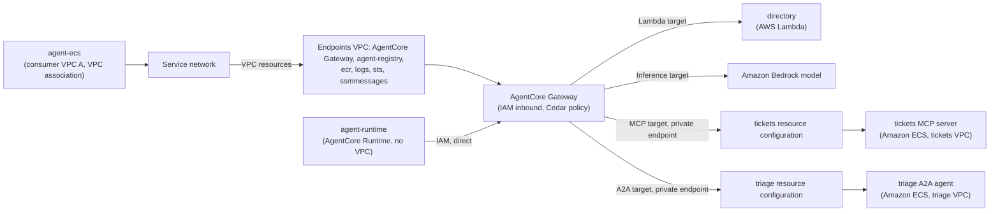

# Amazon VPC Lattice - Amazon Bedrock AgentCore Gateway

This pattern shows how VPC Lattice simplifies private connectivity around an [Amazon Bedrock AgentCore Gateway](https://docs.aws.amazon.com/bedrock-agentcore/latest/devguide/gateway.html), on both sides of it. On the consumer side, one service network carries agents in any number of VPCs to a single, centralized AgentCore Gateway endpoint. On the provider side, AgentCore Gateway itself uses VPC Lattice to reach private targets: each backend, in its own VPC and possibly its own account, is published once as a VPC Lattice resource configuration, which its owner controls and can share.

> **Use case**: an IT helpdesk agent looks up an employee in the **directory** API, opens a ticket with the **tickets** MCP server, and asks the **triage** agent for a priority, all through AgentCore Gateway. The agents have no AgentCore Gateway configuration: they find AgentCore Gateway's endpoints in AWS Agent Registry on every request, and the AgentCore Gateway policy decides with each caller's IAM identity which tools, agents and models it may use.



> **Note**: Some AgentCore integrations are native and need no VPC Lattice: an agent on AgentCore Runtime without a VPC calls AgentCore Gateway directly with its IAM role (use VPC mode only when the agent must also reach private resources itself), and AWS Lambda functions and Amazon Bedrock models are native AgentCore Gateway targets. Using them directly is the best practice, and this pattern does so, so the VPC Lattice parts show where a VPC is involved. To compare this pattern with the others in this section, see the [Agentic Architectures overview](../).

## How VPC Lattice simplifies private connectivity to and from AgentCore Gateway

- **Consumers: one centralized AgentCore Gateway endpoint.** AgentCore Gateway's interface endpoint is published once as a VPC resource in a service network, with the other AWS endpoints. Every VPC that joins the service network reaches AgentCore Gateway by its own DNS name, so adding a consumer VPC adds a VPC association (or a service network endpoint), not another set of interface endpoints.
- **Providers: one resource configuration per backend.** For a target in a VPC, AgentCore Gateway uses a private endpoint built on VPC Lattice: a resource gateway in the backend's VPC and a resource configuration for the backend. Each backend here runs in its own VPC, as if each had a different owner.

> **Managed or self-managed private endpoints**: with a [managed private endpoint](https://docs.aws.amazon.com/bedrock-agentcore/latest/devguide/vpc-egress-private-endpoints.html), AgentCore creates the VPC Lattice resources for you, and you only give it the VPC and subnets. That's the simpler option when the same team owns the backend and AgentCore Gateway and doesn't need control over those resources. This pattern uses **self-managed** private endpoints, where the backend's owner creates the resource gateway and resource configuration: they're visible, their connections can be logged, access can be revoked per backend, and they can be shared with another account (see [Multi-account](#multi-account-backends-owned-by-other-accounts)).

## What gets deployed

| Component | Details |
|-----------|---------|
| **Endpoints VPC** | Interface endpoints for the AgentCore Gateway, `agent-registry`, `ecr.api`, `ecr.dkr`, `logs`, `sts` and `ssmmessages`, a resource gateway, and one single resource configuration per endpoint (custom domain name = the service's DNS name, or AgentCore Gateway's) |
| **Service network** | Resource associations for every endpoint, and access logging. It holds no services, so it has no auth policy |
| **AgentCore Gateway** | IAM inbound authorization and a policy engine in `ENFORCE` mode, with one Cedar policy per caller. Four targets: `directory` (AWS Lambda), `model` (Amazon Bedrock, `bedrock-mantle` connector, called with the Anthropic Messages API), `tickets` (MCP server) and `triage` (A2A agent), the last two with self-managed private endpoints |
| **`directory`** | REST API on AWS Lambda, a Lambda target whose operations AgentCore Gateway exposes as MCP tools |
| **Tickets VPC** | `tickets` MCP server on Amazon ECS Fargate behind an internal Application Load Balancer (HTTPS, `tickets.<domain>`), a resource gateway and a resource configuration for the load balancer, and a VPC association to the service network for the central endpoints |
| **Triage VPC** | `triage` A2A agent (Strands Agents) on Amazon ECS Fargate, set up like the tickets VPC (`triage.<domain>`). The triage agent calls the model through AgentCore Gateway |
| **Consumer VPC A** | `agent-ecs` (Strands Agents on Amazon ECS Fargate), VPC association to the service network with private DNS |
| **`agent-runtime`** | The same agent image on AgentCore Runtime in public network mode (no VPC) |
| **AWS Agent Registry** | An IAM registry with three records for AgentCore Gateway's endpoints: its MCP endpoint, the triage agent (agent card) and its model endpoint (custom descriptor). The IaC creates them and submits them for approval (auto-approved) |
| **Amazon S3 gateway endpoints** | One per VPC that pulls container images (gateway endpoints can't be centralized) |

| Flow | Path | Decided by |
|------|------|------------|
| Agent -> registry | `agent-registry` VPC resource (`agent-ecs`), or directly (`agent-runtime`) | IAM |
| Agent -> AgentCore Gateway | AgentCore Gateway VPC resource (`agent-ecs`), or directly (`agent-runtime`) | IAM (`bedrock-agentcore:InvokeGateway`), then the AgentCore Gateway policy per tool, agent or model |
| AgentCore Gateway -> directory, model | Native targets | AgentCore Gateway's service role |
| AgentCore Gateway -> tickets, triage | Self-managed private endpoint: resource configuration, resource gateway, load balancer | The resource configuration the target names, and the security groups in the backend's VPC |
| Triage -> model | AgentCore Gateway VPC resource (triage VPC), then the `model` target | IAM, then the AgentCore Gateway policy (model only) |

## Security architecture

Security works at three levels: VPC Lattice decides which networks reach **AgentCore Gateway** and which **backends** it reaches, AgentCore Gateway decides what each **agent** may use, and the **user-level** decisions can live in AgentCore Gateway too. This pattern uses only VPC resources, which carry TCP connections, and VPC Lattice auth policies apply to services, not resources, so every request-level decision is AgentCore Gateway's. The service network access logs and AgentCore Gateway's logs record every decision.

### Network access: what VPC Lattice controls

- **Consumers:** only VPCs connected to the service network reach AgentCore Gateway's endpoint, and the security group on each VPC association decides which workloads in that VPC can.
- **Providers:** the backend's owner decides who reaches it by deciding who may use its resource configuration: here, AgentCore Gateway in the same account; across accounts, the accounts it's shared with. The security groups allow only the resource gateway to reach the load balancer, and only the load balancer to reach the tasks. Removing the configuration from the share, or deleting it, cuts AgentCore Gateway off from that backend alone.

### Agent-level access: IAM and the AgentCore Gateway policy

AgentCore Gateway supports several types of [inbound authorization](https://docs.aws.amazon.com/bedrock-agentcore/latest/devguide/gateway-inbound-auth.html): IAM, a JSON Web Token (JWT) from your identity provider, and offloaded types (authenticate only, or no authorization), where the decision is left to the policy engine, an interceptor Lambda function or the target. This pattern uses IAM (`AWS_IAM`): every caller signs its requests with its IAM role (SigV4, `bedrock-agentcore`), and each role may invoke only this AgentCore Gateway (`bedrock-agentcore:InvokeGateway` on its ARN).

On every request, AgentCore Gateway's [policy engine](https://docs.aws.amazon.com/bedrock-agentcore/latest/devguide/policy.html) (Cedar) then decides which tool, agent or model each caller may use. Because AgentCore Gateway sees each tool call, it can allow or deny single tools, which a network can't do for MCP (every MCP call is a `POST` to one path). AgentCore Gateway also lists only the tools a caller is allowed to use.

| Caller (IAM role) | Tools | Agents | Model |
|-------------------|-------|--------|-------|
| `agent-ecs` | All (tickets and directory) | `triage` | Yes |
| `agent-runtime` | All except `createEmployee` | `triage` | Yes |
| triage | None | None | Yes |

### Backend access: outbound authorization

AgentCore Gateway authenticates to each target with its [outbound authorization](https://docs.aws.amazon.com/bedrock-agentcore/latest/devguide/gateway-outbound-auth.html):

| Target | Outbound authorization |
|--------|------------------------|
| `directory` (AWS Lambda) | AgentCore Gateway's service role, which may invoke only this function |
| `model` (Amazon Bedrock) | AgentCore Gateway's service role |
| `triage` (A2A, Amazon ECS) | AgentCore Gateway's service role (SigV4); the demo agent doesn't verify the signature |
| `tickets` (MCP server, Amazon ECS) | None |

> **Note**: The VPC-hosted backends trust the network path instead of authenticating AgentCore Gateway. In production, use outbound authorization the backend can verify, such as OAuth or an API key from AgentCore Identity.

### User-level access

IAM identifies the agent, not the user the agent acts for. AgentCore Gateway is the natural place for user-level decisions (*Ana may read her own tickets, not everyone's*), and AgentCore Gateway covers them at each step. This pattern doesn't deploy them, to keep the focus on the connectivity.

- **Inbound:** AgentCore Gateway validates a JWT from your identity provider instead of IAM, so it knows the user.
- **Policy:** the policy engine's rules can use the user's identity and the tool's input parameters, not only the caller and the tool.
- **Outbound:** AgentCore Gateway exchanges the user's token [on behalf of the user](https://docs.aws.amazon.com/bedrock-agentcore/latest/devguide/on-behalf-of-token-exchange.html) for a token scoped to the target, carrying both the user's and the agent's identity, so the backend can make its own user-level decisions.

### Observability

- **`/aws/vpclattice/service-network-<identifier>`**: `RESOURCE` entries for every connection to the central endpoints, including `agent-ecs`'s connections to AgentCore Gateway and the triage agent's model calls.
- **`/aws/vpclattice/resource-config-<backend>-<identifier>`**: one group per VPC-hosted backend, with every connection from AgentCore Gateway to that backend, logged by the backend's owner.
- **`/aws/vendedlogs/bedrock-agentcore/gateway/APPLICATION_LOGS/<gateway-id>`**: AgentCore Gateway's [application logs](https://docs.aws.amazon.com/bedrock-agentcore/latest/devguide/observability-gateway-metrics.html). Where the VPC Lattice logs show each connection, these show each request: the MCP method, the tool called, any target error, and the policy engine's decision for each tool call (`ALLOW` or `DENY`, the caller and the determining policy). AgentCore Gateway also publishes metrics (`AWS/Bedrock-AgentCore`) without any setup; traces need [CloudWatch Transaction Search](https://docs.aws.amazon.com/bedrock-agentcore/latest/devguide/observability-configure.html), an account-wide setting this pattern doesn't change.

The agents, the backends and the Lambda function write their application logs to CloudWatch Logs as well.

## Multi-account: backends owned by other accounts

The pattern deploys everything in one account to keep it simple. When the backends belong to other accounts, each backend's owner keeps its backend in its own VPC and shares the resource configuration with AgentCore Gateway's account, with standard VPC Lattice sharing:

1. **Backend owner**: creates the resource gateway and the resource configuration in its VPC, as `backends.tf` and `backends.yaml` do, and shares the resource configuration with AgentCore Gateway's account over AWS RAM. See [Share VPC Lattice entities](https://docs.aws.amazon.com/vpc-lattice/latest/ug/sharing.html).
2. **AgentCore Gateway owner**: accepts the share, then creates AgentCore Gateway target with a self-managed private endpoint that names the shared resource configuration's ARN. See [Cross-account private resources](https://docs.aws.amazon.com/bedrock-agentcore/latest/devguide/vpc-egress-private-endpoints.html#lattice-vpc-egress-cross-account).

Managed private endpoints don't support backends in other accounts. The callers can be in other accounts too: the service network, or AgentCore Gateway's resource configuration alone, is shared with their accounts the same way, as in the [Multi-Account Patterns](../../2-multi_account/), and AWS Agent Registry is [shared over AWS RAM](https://docs.aws.amazon.com/bedrock-agentcore/latest/devguide/registry-cross-account-sharing.html).

## Prerequisites

- **Amazon Bedrock model access** for the model in `model_id` / `MODEL_ID` (default `anthropic.claude-haiku-4-5`), as listed by Amazon Bedrock's OpenAI-compatible endpoint, which AgentCore Gateway's `model` target uses.
- **Docker with `buildx`**: the agent, triage and tickets images are built for `linux/arm64`, because AgentCore Runtime runs ARM64 containers. On an x86 machine, `buildx` needs QEMU emulation.
- **An AWS Region where AgentCore Gateway, AgentCore Runtime and AWS Agent Registry are available.**
- **A domain and an ACM public certificate** for the VPC-hosted backends' names (`tickets.<domain>` and `triage.<domain>`), on their load balancers. The certificate must cover `*.<domain>` and be in the account and Region you deploy to. AgentCore Gateway requires a publicly trusted certificate on private targets; no DNS records are needed.
- **The [Session Manager plugin for the AWS CLI](https://docs.aws.amazon.com/systems-manager/latest/userguide/session-manager-working-with-install-plugin.html)**, installed on the machine you test from: chatting with `agent-ecs` goes through ECS Exec. Testing `agent-runtime` doesn't need it.

> **Note**: The default model is an example. Use the model your organization approves and that fits your use case (quality, latency, cost and data residency).

## Implementation

| IaC Tool | Location |
|----------|----------|
| **CloudFormation** | [`./cloudformation/`](./cloudformation/) |
| **Terraform** | [`./terraform/`](./terraform/) |

Both implementations build the agent, triage and tickets images from [`../applications/`](../applications/), shared by every pattern in this section.

## Testing Connectivity

Connect to either consumer agent and pilot it with the example prompts. The chat client lists them when it starts: type a number to send one, or type your own prompt. Each prompt is a separate invocation, so the agent doesn't keep the conversation between prompts.

| IaC Tool | From | `agent-ecs` (ECS Exec) | `agent-runtime` (`InvokeAgentRuntime`) |
|----------|------|------------------------|----------------------------------------|
| **Terraform** | [`./terraform/`](./terraform/) | `./chat.sh ecs` | `./chat.sh runtime` |
| **CloudFormation** | [`./cloudformation/`](./cloudformation/) | `make chat AGENT=ecs` | `make chat AGENT=runtime` |

<details>
<summary>Click to expand testing steps</summary>

After each reply, the chat client prints the **calls made**. The agents have no AgentCore Gateway configured: every prompt starts with a lookup in AWS Agent Registry, then the agent loads the tools the AgentCore Gateway policy allows from AgentCore Gateway's MCP endpoint. Each model turn goes to the model through AgentCore Gateway, and each tool or agent call goes through AgentCore Gateway to the backend. Each step shows the expected output from `agent-ecs`; `agent-runtime` makes the same calls with the same results, except in step 4. The model's wording varies, and it may add or reorder calls.

#### Step 1: Look up an employee (Lambda target)

```text
you> Who is Ana? Which department is she in and which device does she use?
  Calls made:
  1. agent-registry: ListDiscoverableRegistryRecords, BatchGetDiscoverableRegistryRecord -> gateway-llm, gateway-triage, gateway-tools
  2. gateway-tools: MCP tools/list: load the tools the gateway's policy allows
  3. model anthropic.claude-haiku-4-5 through gateway-llm: decides to call directory___getEmployee({"id": "ana"})
  4. gateway-tools: MCP tools/call directory___getEmployee -> 200
  5. model anthropic.claude-haiku-4-5 through gateway-llm: writes the final answer
agent-ecs> Ana is **Ana Garcia**. She works in the **Engineering** department and uses the device **laptop-0042**.
```

AgentCore Gateway invokes the directory function with the tool's arguments.

#### Step 2: Report an issue (A2A and MCP targets through private endpoints)

```text
you> Ana's laptop doesn't boot and she can't work. How urgent is it?
  Calls made:
  1. agent-registry: ListDiscoverableRegistryRecords, BatchGetDiscoverableRegistryRecord -> gateway-llm, gateway-tools, gateway-triage
  2. gateway-tools: MCP tools/list: load the tools the gateway's policy allows
  3. model anthropic.claude-haiku-4-5 through gateway-llm: decides to call directory___getEmployee({"id": "ana"}), send_agent_message({"service": "gateway-triage", "text": "Employee ana has a laptop that doesn't boot and cannot work. What priority level should this issue be assigned?"})
  4. gateway-tools: MCP tools/call directory___getEmployee -> 200
  5. gateway-triage: A2A message/send -> 200
  6. model anthropic.claude-haiku-4-5 through gateway-llm: decides to call tickets___create_ticket({"employee_id": "ana", "summary": "Laptop doesn't boot - employee unable to work", "priority": "high"})
  7. gateway-tools: MCP tools/call tickets___create_ticket -> success
  8. model anthropic.claude-haiku-4-5 through gateway-llm: writes the final answer
agent-ecs> **Ticket Created: TCK-ccb85708**

**Priority: HIGH**

Ana Garcia from the Engineering department has a critical issue - her laptop (laptop-0042) won't boot and she's unable to work. This ticket has been marked as high priority and should be handled urgently.
```

The model may call several tools in one turn, as here (the directory lookup and triage together). The triage agent decides the priority with its own model call, which goes back through AgentCore Gateway with the triage agent's role.

#### Step 3: List tickets (MCP target through a private endpoint)

```text
you> Which tickets are open for Ana?
  Calls made:
  1. agent-registry: ListDiscoverableRegistryRecords, BatchGetDiscoverableRegistryRecord -> gateway-llm, gateway-tools, gateway-triage
  2. gateway-tools: MCP tools/list: load the tools the gateway's policy allows
  3. model anthropic.claude-haiku-4-5 through gateway-llm: decides to call tickets___list_tickets({"employee_id": "ana"})
  4. gateway-tools: MCP tools/call tickets___list_tickets -> success
  5. model anthropic.claude-haiku-4-5 through gateway-llm: writes the final answer
agent-ecs> There is 1 open ticket for Ana:

- **Ticket ID:** TCK-ccb85708
- **Summary:** Laptop doesn't boot - employee unable to work
- **Priority:** High
- **Created:** 2026-10-26 at 16:04:35 UTC
```

#### Step 4: Add an employee (per-tool permissions in AgentCore Gateway)

This step is the one where the two consumer agents get different results. Both may call AgentCore Gateway, but the AgentCore Gateway policy doesn't allow `agent-runtime` the directory's `createEmployee` tool, so AgentCore Gateway doesn't even list it for that agent. Run the prompt from each agent.

**From `agent-ecs`** (`./chat.sh ecs` or `make chat AGENT=ecs`): allowed.

```text
you> Add Zoe Lee to the directory with the identifier zoe.
  Calls made:
  1. agent-registry: ListDiscoverableRegistryRecords, BatchGetDiscoverableRegistryRecord -> gateway-llm, gateway-triage, gateway-tools
  2. gateway-tools: MCP tools/list: load the tools the gateway's policy allows
  3. model anthropic.claude-haiku-4-5 through gateway-llm: decides to call directory___createEmployee({"id": "zoe", "name": "Zoe Lee"})
  4. gateway-tools: MCP tools/call directory___createEmployee -> 201
  5. model anthropic.claude-haiku-4-5 through gateway-llm: writes the final answer
agent-ecs> Perfect! I've successfully added Zoe Lee to the directory with the identifier **zoe**. The employee is now in the system and ready to use.
```

**From `agent-runtime`** (`./chat.sh runtime` or `make chat AGENT=runtime`): the tool isn't available.

```text
you> Add Zoe Lee to the directory with the identifier zoe.
  Calls made:
  1. agent-registry: ListDiscoverableRegistryRecords, BatchGetDiscoverableRegistryRecord -> gateway-llm, gateway-triage, gateway-tools
  2. gateway-tools: MCP tools/list: load the tools the gateway's policy allows
  3. model anthropic.claude-haiku-4-5 through gateway-llm: writes the final answer
agent-runtime> I don't have the ability to add new employees to the directory. The tools available to me only allow me to:

- List employees in the directory
- Look up existing employees by their identifier
- Create helpdesk tickets for existing employees
- List helpdesk tickets
```

#### Step 5: Read the logs

```bash
aws logs tail /aws/vpclattice/service-network-<identifier> --since 15m          # callers in a VPC -> AgentCore Gateway and endpoints
aws logs tail /aws/vpclattice/resource-config-tickets-<identifier> --since 15m  # AgentCore Gateway -> tickets
aws logs tail /aws/vpclattice/resource-config-triage-<identifier> --since 15m   # AgentCore Gateway -> triage
aws logs tail "$(terraform output -raw gateway_log_group)" --since 15m          # AgentCore Gateway requests
```

With CloudFormation, the AgentCore Gateway log group is the `GatewayLogGroup` output of the `gateway` stack.

**Expected Result**: in the service network group, `RESOURCE` entries for `agent-ecs`'s connections to AgentCore Gateway's resource configuration (from consumer VPC A) and for the triage agent's model calls (from the triage VPC); `agent-runtime` doesn't appear, because it calls AgentCore Gateway directly. In each backend's group, one entry per connection from AgentCore Gateway to that backend. In AgentCore Gateway's group, the requests from both agents, including `agent-runtime`'s: each MCP method, each tool run, the A2A and model requests, and a `Policy evaluation completed` entry per tool call with the decision, the caller's role and the determining policy (for example `allow_agent_ecs`). An `Unsupported protocol version` entry before each `initialize` is the MCP client negotiating the protocol version, not a failure.

</details>

## Cleanup

Tear down the resources when you are finished to stop incurring charges. While deployed, this pattern runs ECS tasks (agent, tickets and triage), two internal Application Load Balancers, an AgentCore Runtime agent, interface endpoints, VPC Lattice resource configurations, and CloudWatch Logs vended-logs access logging.

| IaC Tool | From | Command |
|----------|------|---------|
| **Terraform** | [`./terraform/`](./terraform/) | `terraform destroy` |
| **CloudFormation** | [`./cloudformation/`](./cloudformation/) | `make undeploy` |

## Next Steps

1. **Compare the gateways**: see the [direct](../1-direct_agent_connectivity/) pattern (no gateway) and the [self-hosted AI gateway](../2-self_hosted_ai_gateway/) pattern.
2. **Move a backend to another account**: share its resource configuration over AWS RAM, as described in [Multi-account](#multi-account-backends-owned-by-other-accounts).
